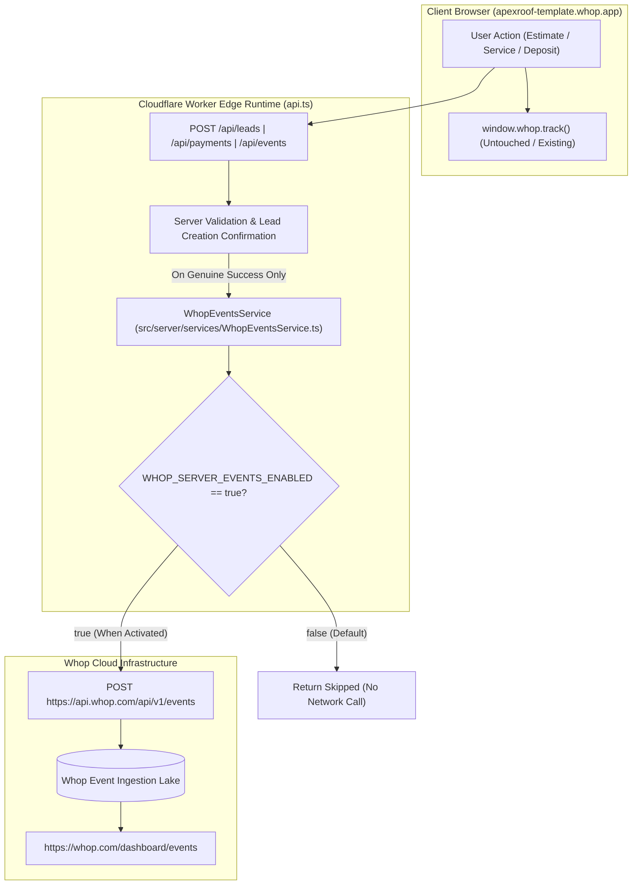

# Whop Server-Side Events API Integration Guide

**Service**: `WhopEventsService` (`src/server/services/WhopEventsService.ts`)  
**Git Branch**: `feature/whop-server-side-events`  
**Endpoint**: `POST https://api.whop.com/api/v1/events`  
**API Specification**: Whop Events API (`Api-Version-Date: 2026-11-03-1`)  
**Status**: Feature implemented, tested with 100% mocked calls, flag disabled by default (`WHOP_SERVER_EVENTS_ENABLED=false`).

---

## 1. Architecture Overview

The server-side events integration introduces a dedicated, isolated service (`WhopEventsService`) running inside the Cloudflare Workers edge environment. It decouples conversion attribution from client browser quirks, adblockers, and browser-side runtime errors.



### Key Architectural Decisions:
1. **Zero Browser Key Exposure**: All requests to `POST /api/v1/events` originate server-side using `WHOP_COMPANY_API_KEY`. No secret keys or bearer credentials exist in client bundles.
2. **Fail-Closed Feature Flag**: Controlled by `WHOP_SERVER_EVENTS_ENABLED=false`. When disabled, the service exits immediately without making outbound HTTP requests.
3. **No Interchangeability Assumption**: Browser-side `window.whop.track()` and server-side `POST /api/v1/events` serve distinct purposes. The client pixel is maintained as-is; server events provide durable conversion attribution.

---

## 2. Three Event Trigger Definitions

### Event 1: `estimate_requested`
- **Trigger Location**: Inside `POST /api/leads` (`src/server/api.ts`).
- **Trigger Boundary**: **Strictly after** the estimate request passes server-side validation AND `createWhopLead` returns a confirmed Whop Lead ID (`result.success === true && result.leadId`).
- **Safety**: If Lead creation fails, is rate-limited, or fails validation, **no event is emitted**.

### Event 2: `service_viewed`
- **Trigger Location**: Inside `POST /api/events` (`src/server/api.ts`).
- **Trigger Boundary**: Dispatched when a customer intentionally engages with a roofing service (e.g., clicking to inspect architectural shingle specifications or clicking the primary service CTA).
- **Deduplication**: Hourly resolution hashing prevents repeated component re-renders or page reloads from generating duplicate events.

### Event 3: `deposit_started`
- **Trigger Location**: Inside `POST /api/payments` (`src/server/api.ts`) and `POST /api/events`.
- **Trigger Boundary**: Dispatched when a customer actively begins the $500 project deposit checkout flow (`plan_8Z1S3Yw1WjX4a` or `setupFutureUsage="off_session"`).
- **Safety**: Does **not** trigger on homepage load, passive scrolling, or modal rendering. Does **not** claim or emit a completed payment.

---

## 3. Exact API Request Structure

All events use the documented Whop custom event format:

### Specification:
- **Endpoint**: `POST https://api.whop.com/api/v1/events`
- **Headers**:
  ```http
  Content-Type: application/json
  Authorization: Bearer <WHOP_COMPANY_API_KEY>
  Api-Version-Date: 2026-11-03-1
  ```

### Example Payload (`estimate_requested`):
```json
{
  "account_id": "biz_yxb2Bl22qgep3g",
  "event_name": "custom",
  "custom_name": "estimate_requested",
  "action_source": "website",
  "event_id": "evt_est_lead_69xncLH4vvPse",
  "event_time": "2026-11-06T19:15:00.000Z",
  "url": "https://apexroof-template.whop.app/#contact",
  "product_id": "prod_r8sfpPYp7nzxz",
  "value": 5000,
  "currency": "usd",
  "user": {
    "email": "sarah.jenkins@gmail.com",
    "name": "Sarah Jenkins",
    "phone": "(512) 555-8921",
    "city": "Austin",
    "state": "TX",
    "postal_code": "78701",
    "country": "US"
  },
  "context": {
    "action_source": "website",
    "utm_source": "direct"
  },
  "idempotency-key": "evt_est_lead_69xncLH4vvPse"
}
```

### Constraints Respected:
- `event_name`: Must be `"custom"`.
- `custom_name`: Must be $\le 35$ characters:
  - `estimate_requested` (18 chars)
  - `service_viewed` (14 chars)
  - `deposit_started` (15 chars)
- `event_id`: Stable unique identifier passed to Whop for server-side deduplication.

---

## 4. Environment Configuration & Feature Flag

### Configuration Variables:
| Variable Name | Environment | Description | Default |
|---|---|---|---|
| `WHOP_SERVER_EVENTS_ENABLED` | Worker Binding / Env | Master feature flag enabling outbound event dispatch | `false` |
| `WHOP_ACCOUNT_ID` | Worker Binding / Env | The Whop business account ID (`biz_...`) | `biz_yxb2Bl22qgep3g` |
| `WHOP_COMPANY_API_KEY` | Worker Secret / Env | Server-side bearer credential with `events:create` permission | *(Secret)* |
| `WHOP_API_ORIGIN` | Worker Binding / Env | Origin URL for Whop API | `https://api.whop.com` |

---

## 5. Error Handling & Deduplication Strategy

1. **Timeout & Abort Handling**: Outbound calls to Whop Events API enforce an `AbortController` timeout (default 5,000ms). If Whop takes longer, the worker catches the abort and returns HTTP 504 without blocking edge responses.
2. **In-Memory Cache Deduplication**: `WhopEventsService` maintains an in-memory set of recently dispatched `event_id` strings. If an identical event ID is submitted twice, it is skipped with `{ skipped: true, reason: 'DEDUPLICATED' }`.
3. **HTTP Failure Non-Throwing Contract**: Any non-2xx response from Whop (e.g. 400, 401, 422, 500) returns a structured `{ success: false, status, error }` object. The customer's primary workflow (such as estimate submission) is never broken by an event reporting failure.

---

## 6. Event Verification & Four-Level Proof Procedure

To verify event ingestion on Whop, observe the strict four-level verification model:

```
[Level 1: Unit Test Mock]  -->  [Level 2: API 201 Response]  -->  [Level 3: List Events Query]  -->  [Level 4: Whop Dashboard UI]
```

### Level 1: Unit-Test Success (Completed)
- Run `npm test`. Confirms request formatting, parameter limits, timeout handling, and deduplication logic using 100% mocked responses.

### Level 2: API 201 Response (Production/Staging Post-Activation)
- When enabled, `POST /api/v1/events` returns HTTP 201 with `{ id: "evt_..." }`.

### Level 3: List Events Verification (`GET /api/v1/events`)
Execute an authenticated query using the official List Events endpoint:
```bash
curl -s -X GET "https://api.whop.com/api/v1/events?account_id=biz_yxb2Bl22qgep3g&from=2026-11-06T00:00:00Z&to=2026-11-06T23:59:59Z" \
  -H "Authorization: Bearer <WHOP_COMPANY_API_KEY>" \
  -H "Api-Version-Date: 2026-11-03-1"
```
Filter specifically for custom events:
```bash
whop events list --account_id biz_yxb2Bl22qgep3g \
  --from "2026-11-06T00:00:00Z" \
  --to "2026-11-06T23:59:59Z" \
  --format json
```
Check that the returned array contains:
- `event_name`: `"custom"`
- `custom_name`: `"estimate_requested"` | `"service_viewed"` | `"deposit_started"`
- Matching `event_id`.

### Level 4: Whop Seller Dashboard Verification
1. Log in to the Whop Seller Dashboard as `biz_yxb2Bl22qgep3g`.
2. Navigate to **Analytics** $\rightarrow$ **Events** (`https://whop.com/dashboard/biz_yxb2Bl22qgep3g/events/` or `/analytics`).
3. Confirm custom events appear in the live event stream with timestamps and associated user metadata.

---

## 7. Future Activation Procedure (Do NOT Execute Yet)

When the business owner authorizes live event dispatch:
1. Ensure the Company API key has `events:create` and `events:read` scopes.
2. In Cloudflare Workers or via `whop apps secrets set`:
   ```bash
   whop apps secrets set --secret WHOP_SERVER_EVENTS_ENABLED=true
   ```
3. Test a single estimate inquiry and run the Level 3 List Events query to confirm ingestion.

---

## 8. Limitations and Unverified Assumptions

1. **Sandbox vs Production Ingestion**: The Whop Events API exists in both production (`api.whop.com`) and sandbox (`sandbox-api.whop.com`). Production credentials cannot query sandbox events.
2. **Dashboard Propagation Latency**: Events dispatched to `POST /api/v1/events` appear immediately in the List Events API, but aggregated dashboard charts may have a 5–15 minute caching window.
3. **No Retroactive Ingestion**: The Events API records events moving forward from the timestamp of dispatch; events that occurred prior to feature activation will not appear.
